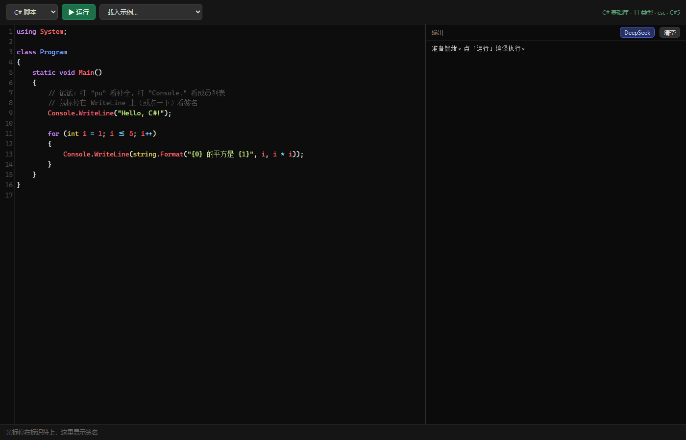
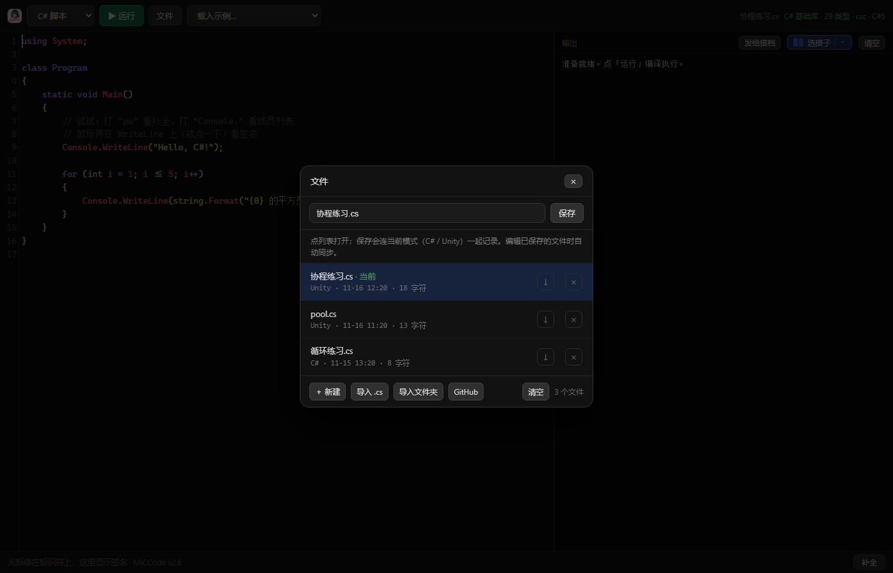
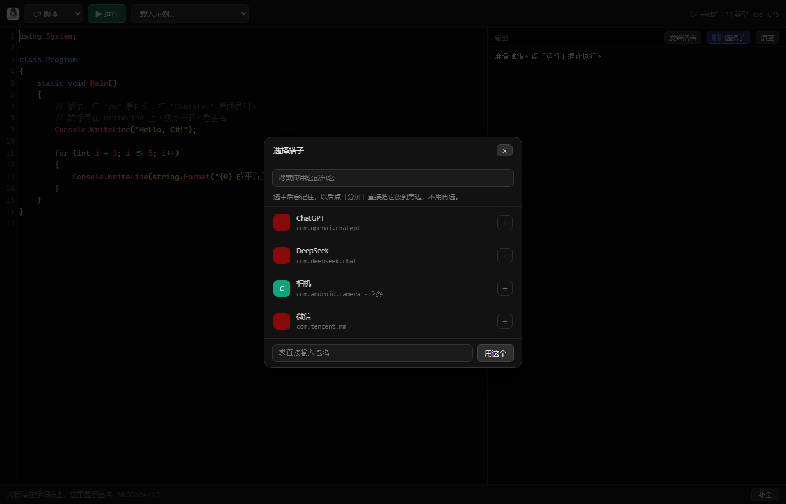

# MiCCode

在**安卓平板 / 手机**上写 C# 的离线编辑器：语法高亮、上下文补全、悬停看 API 签名、文件管理，可选接 Termux 用 mono 本地编译运行。

> 定位很明确：**不需要联网就能写、能补全、能查 API；想真正跑起来时，交给 Termux 里的编译器。**



---

## 为什么做这个

在 PC 上写 Unity 脚本没问题，但碎片时间（床上、通勤、没网）想在平板上改脚本、写练习时，现成方案都不合适：

| 方案 | 问题 |
|---|---|
| VS Code Remote / 云 IDE | 必须有网，且 PC 得开着 |
| 手机上的代码编辑器 | 普遍只有关键字补全，没有 C# 语义提示 |
| Unity 编辑器 | 根本没有安卓版 |

MiCCode 的取舍是：**能离线做的全做进 APK，真正需要编译的部分交给 Termux**。所以它装完就能用——只是「运行」按钮需要 Termux 配合。

---

## 功能

| 能力 | 说明 | 需要什么 |
|---|---|---|
| 语法高亮 / 行号 / 括号匹配 | CodeMirror 5，本地打包 | 无 |
| 关键字补全 | 打 `pu` → `public` / `private` / `protected` | 无 |
| 类型补全 | 打 `IEn` → `IEnumerator`（13764 条 API 索引） | 无 |
| 成员补全（L2） | `Console.` → 列出成员；`Queue<int> q` 后 `q.` 能推断类型 | 无 |
| 悬停看签名 | 列出全部重载 + 说明，含中文手写文档 | 无 |
| 自动补 using | 选中 `SceneManager` 自动插入 `using UnityEngine.SceneManagement;` | 无 |
| 文件管理 | 新建 / 命名保存 / 打开 / 删除 / 一键清空 | 无 |
| 导入 | 单个 `.cs`、多选、整个文件夹（递归）、GitHub 仓库 | 无（GitHub 需联网） |
| 导出 | 写到 `下载/MiCCode/` | 无 |
| 分屏搭子 | 一键把 AI 应用放到相邻窗口 | 无 |
| **编译运行** | 点「运行」出结果 | **Termux + mono**（或连 PC） |




---

## 三个关键设计

### 1. 离线符号表：不做语言服务器，只做一张查得动的表

补全和悬停通常要 Roslyn（几百 MB 的 .NET 编译器平台），安卓上跑不动。这里的做法是**把 API 索引预先算好**：

- 从 Unity 安装目录的 90 个 XML 文档（`Managed/UnityEngine/*.xml`）解析出 **13764 条成员、1339 个类型**，压缩到 **1.84 MB** 的 `symbols.json`
- 手写补充 218 条基础类库符号（`Console` / `List<T>` / `Queue<T>` / `Thread` / `IEnumerator` …）——因为 Unity 的 XML **只覆盖 `UnityEngine.*`**
- 手写 19 条 `MonoBehaviour` 生命周期（`Awake`/`Start`/`Update`/`OnTriggerEnter`…）——这些是 `protected`，XML 里根本不收录
- 每个类型带命名空间映射，共 1493 条，用于「自动补 using」

代价是：只能查到**符号表里有的东西**，查不到泛型约束、重载解析这类语义信息。收益是：**整套索引 1.84 MB，断网可用，冷启动毫秒级**。

### 2. 轻量 L2 补全：不依赖 Roslyn 的「猜类型」

「`sb.` 能列出 `StringBuilder` 的成员」这件事，本质是知道 `sb` 是什么类型。完整做法是语义分析，这里的做法是三条正则 + 一张表：

- 扫描当前文件里的 `var x = new Foo()` / `Foo x = ...`，建立局部变量表
- **先剥掉泛型参数再匹配**（`Queue<int> q` → `Queue q`），否则 `<int>` 会把声明识别全挡住
- 解析 `class X : MonoBehaviour`，把基类成员直接放进候选（所以 `Sta` 能出 `StartCoroutine`）
- 全量成员名池（约 5000 条），支持「直接打成员名」补全，同名成员优先 `MonoBehaviour`

准确率不是 100%，但练习场景都是单文件小程序，实测够用。

### 3. WebView 壳 + 本地编译服务：界面离线，编译外挂

```
┌─────────────── APK ───────────────┐        ┌────── Termux ──────┐
│ WebView 拦截 http://miccode.local │        │ python server.py   │
│   → 从 assets/www 读文件（离线）  │  HTTP  │ mcs 编译 + mono 跑 │
│ CodeMirror + symbols.json         │ ─────► │ 127.0.0.1:8080     │
└───────────────────────────────────┘        └────────────────────┘
```

- 页面域名是虚拟的 `miccode.local`，被 `shouldInterceptRequest` 拦下、直接从 APK 的 `assets` 读——**没网、没 Termux 也能打开写代码**
- 只有 `/api/*` 真的发到 `127.0.0.1:8080`，这时才需要 Termux
- 跨域要处理两件事：CORS（页面 origin 是虚拟域），以及 **Private Network Access**（Chromium 从非 localhost 源访问 127.0.0.1 会发 PNA 预检，不回 `Access-Control-Allow-Private-Network: true` 就直接拦掉）
- 服务没起来时，APK 会通过 Termux 官方的 `RUN_COMMAND` Intent 在后台拉起（需要一次授权）

### 工程上的几个坑（都踩过）

| 问题 | 原因 | 解决 |
|---|---|---|
| `apksigner` 死活不生成 v1 签名 | 它按 APK 里声明的 `minSdk` 判断，≥24 就认为 v2 够用 | 把 `minSdk` 降到 21，v1 自动生成；国产安装器只认 v1 |
| 装了 d8 报 `NullPointerException` | build-tools 34 的 d8 与 JDK 21 不兼容 | d8 用 build-tools 37，其余用 34 |
| 文件夹导入后代码变成一行 | Java 侧 JSON 转义把 `\n` 压成了空格 | 新增 `jsonEscText`，`\n` 转成 `\\n` |
| 导入后打不了字 | 面板关闭后编辑器没拿到焦点 | 导入/打开/新建后补 `cm.focus()` |
| Termux 里 `pkg update` 一直报 No mirror | 新版 `pkg` 有自己的镜像配置，**不读 `sources.list`** | 改好的 `sources.list` 直接用 `apt` 装 |

---

## 快速开始

### 1. 装 APK

仓库根目录的 [`MiCCode.apk`](MiCCode.apk)，或自己构建（见下）。安装时若提示「安装包已损坏」，通常是文件传输不完整——核对大小，或先卸载旧版。

### 2. 连接 Termux（可选，只为「运行」按钮）

需要 C# 编译器，Termux 里装 mono 即可。**逐块粘贴**执行：

```bash
# 块 1：换清华源 + 装包
echo "deb https://mirrors.tuna.tsinghua.edu.cn/termux/apt/termux-main stable main" > $PREFIX/etc/apt/sources.list
apt update && apt install -y python mono unzip
```

> 注意用 `apt` 而不是 `pkg`：新版 `pkg` 不读 `sources.list`，会一直报 `No mirror selected` 并去测海外镜像。
> 想用 `pkg` 就先跑 `termux-change-repo` 在界面里选镜像。

```bash
# 块 2：权限 + 存储 + 防杀后台（弹窗点允许）
mkdir -p ~/.termux && echo "allow-external-apps=true" >> ~/.termux/termux.properties && termux-setup-storage && termux-wake-lock
```

```bash
# 块 3：把项目放到 ~/miccode（zip 从仓库下载，解压到 Downloads 后）
cd ~ && unzip -o ~/storage/downloads/<这里填zip文件名>.zip
# 或直接：
# git clone https://github.com/cxkdz/MiCCode.git MiCCode && cp -r MiCCode/miccode ~/miccode
cd ~/miccode && echo 'class P{static void Main(){System.Console.WriteLine("OK");}}' > t.cs && mcs t.cs && mono t.exe
```

看到 `OK` 说明编译器和运行时都通了。

```bash
# 块 4：启动服务
python server.py --no-browser
```

**判据**：横幅里「编译器」一行是 `mcs`。然后打开 MiCCode，右上角徽标会从橙色「离线 · 只能编辑」变成 `mcs · C#7`。

两个一次性设置：

1. 设置 → 应用 → MiCCode → 权限 → 其他权限 →「在 Termux 环境中运行命令」（**需先装 Termux 这条权限才会出现**；找不到也不影响，手动起服务即可）
2. 设置 → 电池 → 电池优化 → Termux 设为「不优化」

### 3. 不装 Termux 也能用

写代码、补全、悬停签名、文件管理、导入导出全部离线可用，只有「运行」会提示需要服务。也可以让平板连 PC：PC 上 `python server.py --host 0.0.0.0`，平板浏览器打开 `http://<PC的IP>:8080`。

---

## 两种模式

左上角切换：

| 模式 | 补全范围 | 运行 |
|---|---|---|
| **C# 脚本** | 只有基础类库（`Console`/`List`/`Math`…），无 Unity 干扰 | ✅ Termux 可跑 |
| **Unity 脚本** | 加上 13000+ 条 `UnityEngine` API | ❌ 只能编辑（缺 `UnityEngine.dll` 与引擎运行时） |

Unity 模式的价值在于**写脚本时能补全、能查签名**，写完拷回 Unity 编辑器编译。

---

## 自己构建

**不需要 Gradle**，`build.sh` 直接调 SDK 工具链：

```bash
cd miccode/apk && bash build.sh
```

需要（路径在 `build.sh` 顶部改）：

| 用途 | 版本 |
|---|---|
| JDK | 21（Android Studio 自带 `jbr`） |
| build-tools | 34.0.0（打包）+ 37.0.0（d8，34 的 d8 在 JDK 21 上会 NPE） |
| platform | android-34 |

流程：`aapt2 compile → aapt2 link → javac → d8 → 重建 zip 塞 dex → zipalign → apksigner`。

网站部分（`miccode/index.html` 等）会被打包进 APK 的 `assets/www/`，所以**改完网页要重新 build 才会进 APK**。

**签名**：`build.sh` 首次运行会生成 `miccode.keystore`（已被 `.gitignore` 排除）。自己生成的密钥与原版不同，无法覆盖安装，需先卸载。

### 重建符号表

```bash
cd miccode
python build_symbols.py "D:/Unity/Editor/Data/Managed/UnityEngine" -o symbols.json
```

- `build_symbols.py`：解析 Unity 的模块 XML，产出类型 / 成员 / 命名空间索引
- `bcl_symbols.py`：手写的基础类库补充（含 `Thread`、`IEnumerator`、`Queue` 等）
- 想加模块就改 `build_symbols.py` 顶部的 `MODULES` 白名单

---

## 目录结构

```
MiCCode.apk              直接可装的安装包
miccode/
├── index.html           编辑器全部前端逻辑（CodeMirror + 补全 + 悬停 + 文件 + GitHub 拉取）
├── symbols.json         符号表（13764 成员 / 1339 类型 / 1493 命名空间）
├── server.py            本地编译服务（静态托管 + /api/run + /api/info），零依赖
├── build_symbols.py     从 Unity XML 生成符号表
├── bcl_symbols.py       手写 BCL 符号 + 命名空间映射
├── vendor/              CodeMirror 5（已本地化，断网可用）
└── apk/
    ├── build.sh         无 Gradle 构建脚本
    ├── AndroidManifest.xml
    ├── src/             MainActivity.java（WebView 外壳 + 原生桥）
    └── res/             图标与字符串
```

`MainActivity` 提供的原生能力：分屏启动、枚举已安装应用（含真实图标）、文件选择器、文件夹树遍历、导出到下载目录、退出前落盘。

---

## 数据与安全

- 草稿和文件存在 **WebView 的 localStorage**（应用私有存储）
- **崩溃/被杀最多丢最后 0.4 秒**（切后台会立即落盘）；**卸载或清除数据则全部丢失**
- 重要代码建议「导出」到 `下载/MiCCode/`，这是唯一能扛住卸载和换设备的方式
- 不收集任何数据、不联网（除你主动使用的 GitHub 拉取）

---

## 已知限制

- **Unity 脚本不能运行**，只能编辑 + 补全（缺引擎运行时）
- 补全是「查表 + 正则推断」，**不是语义分析**：跨文件引用、泛型约束、重载解析都不支持
- GitHub 拉取只支持**公开仓库**，未登录 API 每小时 60 次
- 文件夹导入受 Android 目录选择器限制：**点文件夹是进入，必须按底部「使用此文件夹」**
- mcs 支持到 C# 7；PC 上的旧 `csc.exe` 只到 C# 5（用 `string.Format` 而非 `$""`）

---

## 许可

暂未指定许可证。如需使用请先联系作者。
